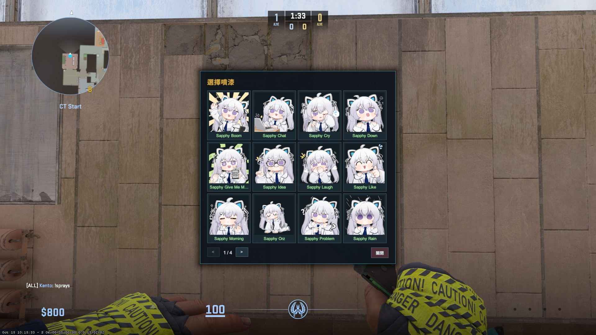
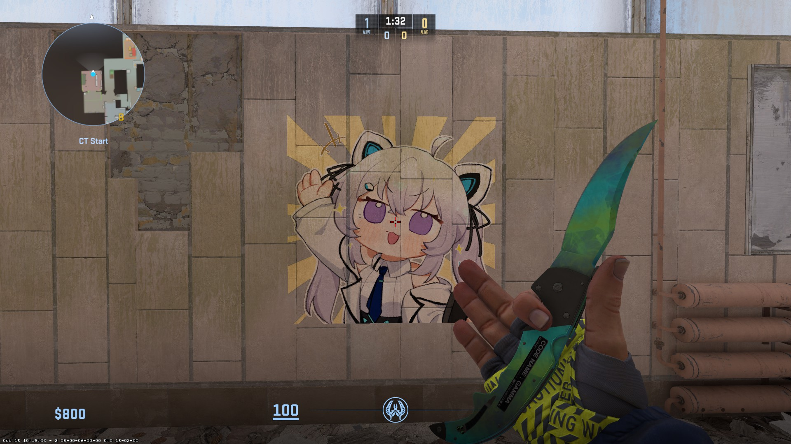

# CS2-Sprays

Players choose a spray from a panorama menu with pictures and put it on walls and floors.

Based on [CS2-Poor-MapAdvertisements](https://github.com/Letaryat/CS2-Poor-MapAdvertisements) by [Letaryat](https://github.com/Letaryat).

- `!sprays` opens a card grid with the picture and name of every spray. Click a card to choose it.
- `!spray` puts the chosen spray where you look and plays `SprayCan.Paint`. Players can bind it: `bind t css_spray`.
- Each player has one spray on the map. A new spray replaces the old one.
- The choice is saved in the [Clientprefs](https://github.com/Cruze03/Clientprefs) cookie `spray_selected` (MySQL or SQLite, as set in Clientprefs). Without Clientprefs the choice is lost when the server restarts.

<p align="center">
    
    
</p>

<sub>Sprays in the screenshots: [SapphyStickers Collection](https://yueou.booth.pm/items/7076197) by 蛸乃ゆえ (illustration: 刺鼻). They are not included in this repository.</sub>

## [📌] Requirements
- CounterStrikeSharp **1.0.374 or newer** (custom HUD panel and ray trace API).
- [Clientprefs](https://github.com/Cruze03/Clientprefs) v1.0.7 or newer, to save the choice. The first build downloads `ClientprefsApi.dll` from the Clientprefs v1.0.7 release into `lib/`; the server loads it from `shared/ClientprefsApi/`.
- A workshop addon that holds the spray materials and the panorama menu, mounted on clients, for example with [MultiAddonManager](https://github.com/Source2ZE/MultiAddonManager).

## [📌] Setup
1. Build with the .NET 10 SDK: `dotnet build CS2-Sprays.sln -c Release`.
2. Copy the build output (`src/bin/Release/net10.0/`, including `lang/`) to `addons/counterstrikesharp/plugins/CS2-Sprays/`.
3. Make the workshop addon (next section) and add it to the server's mounted addons.
4. Restart the server. The config is created in `configs/plugins/CS2-Sprays/`.

## [🎨] Workshop addon
Copy the contents of [`addon/`](addon/) into your addon's content folder (`<CS2>/content/csgo_addons/<addon>/`). It holds the menu and one example spray, matching the plugin's default config:

| Path | What it is |
| --- | --- |
| `panorama/layout/custom_game/sprays.xml` | Menu layout |
| `panorama/styles/custom_game/sprays.css` | Menu style |
| `panorama/styles/custom_game/sprays_images.css` | One picture class per spray |
| `panorama/images/custom_game/sprays/example.png` | Example menu picture, 128x128 |
| `materials/sprays/example.vmat`, `example.png`, `example_trans.png` | Example spray material |

The example is generated by the script below from [`tools/example/Example.png`](tools/example/Example.png).

### Add sprays with the script
[`tools/sync_sprays.py`](tools/README.md) turns a folder of upright images into spray materials, menu pictures, `sprays_images.css` and config entries (steps 1–4 below):

```
python tools/sync_sprays.py --images sprays --config CS2-Sprays.json --addon "<CS2>/content/csgo_addons/<addon>" --compile
```

See [tools/README.md](tools/README.md) for the options.

### Add sprays by hand
1. Make the decal material like `addon/materials/sprays/example.*`: a power-of-2 color texture turned 90 degrees counterclockwise, a translucency mask (white = visible) and a `.vmat` using `csgo_projected_decals.vfx`.
2. Put an upright 128x128 picture in `panorama/images/custom_game/sprays/`, e.g. `logo.png`.
3. Add a line to `sprays_images.css`:
   ```css
   .spray-i-logo { background-image: url("file://{images}/custom_game/sprays/logo.png"); }
   ```
4. Add the spray to the plugin config with `"Image": "logo"`.
5. Compile the addon in the Workshop Tools and publish it.

The custom HUD cannot load images at runtime (only `Panel`, `Label` and `Button` are allowed, and panorama CSS only accepts `file://`, `panel://` and `s2r://`). This is why the pictures have to be in the addon.

## [📝] Configuration
| Option | Description |
| --- | --- |
| Permission (string) | Flag needed for `!sprays` and `!spray`. Empty = everyone |
| Sprays (list) | `Name` (shown in the menu, must be unique), `Material` (`.vmat` path), `Image` (picture class, see above) |
| Panorama Layout (string) | Layout path in the addon |
| Spray Size (float) | Width and height of the spray in units |
| Spray Depth (int) | How deep the decal projects |
| Spray Distance (float) | Max distance between the player's eyes and the surface |
| Spray Cooldown (float) | Seconds between two sprays of one player |
| Spray Sound (string) | Sound event played on a successful spray |
| Debug Mode (bool) | Log errors |

### [📝] Config example
```json
{
  "Permission": "",
  "Sprays": [
    { "Name": "Example", "Material": "materials/sprays/example.vmat", "Image": "example" }
  ],
  "Panorama Layout": "panorama/layout/custom_game/sprays.xml",
  "Spray Size": 64,
  "Spray Depth": 12,
  "Spray Distance": 150,
  "Spray Cooldown": 30,
  "Spray Sound": "SprayCan.Paint",
  "Debug Mode": false,
  "ConfigVersion": 1
}
```

## [⌨️] Commands
| Command | Description |
| --- | --- |
| css_sprays / !sprays | Open the spray menu |
| css_spray / !spray | Use the chosen spray |

## [❤️] Special thanks to:
- [Letaryat](https://github.com/Letaryat) - [CS2-Poor-MapAdvertisements](https://github.com/Letaryat/CS2-Poor-MapAdvertisements), the map advertisement plugin this project started from, and its env_decal setup and texture orientation.
- [Cruze03](https://github.com/Cruze03) - [Clientprefs](https://github.com/Cruze03/Clientprefs), for saving player choices.
- [f3nixCoding](https://github.com/f3nixCodings) - For updated function with keyvalues for decals.
